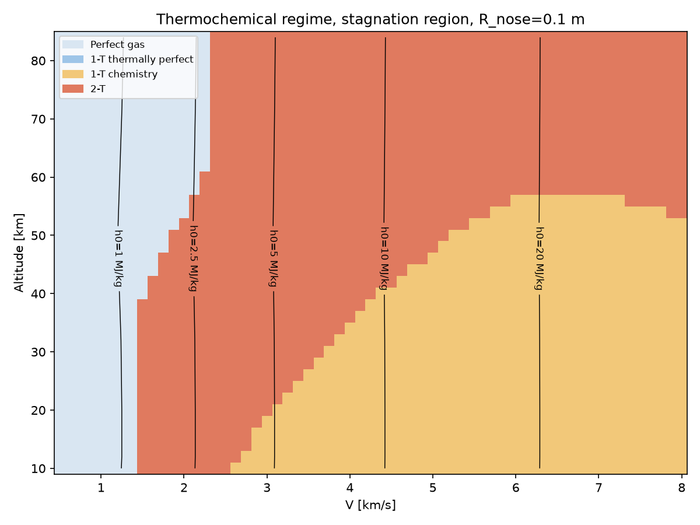

# hypersonic_regime_estimator
Python scripts to estimate relevant physics based 



Velocity-altitude map of the recommended thermochemical model in the stagnation
region (R_nose = 0.1 m), with total-enthalpy contours. Regenerate with
`regime --map docs/regime_map.png`.

## Install

```sh
python3 -m venv .venv
source .venv/bin/activate
pip install -e .          # or: pip install -e '.[plot]' for matplotlib plotting
```

## Use

```sh
regime --alt 40 --vel 3000          # same as: python -m regime ...
```

```python
from regime import evaluate
```
